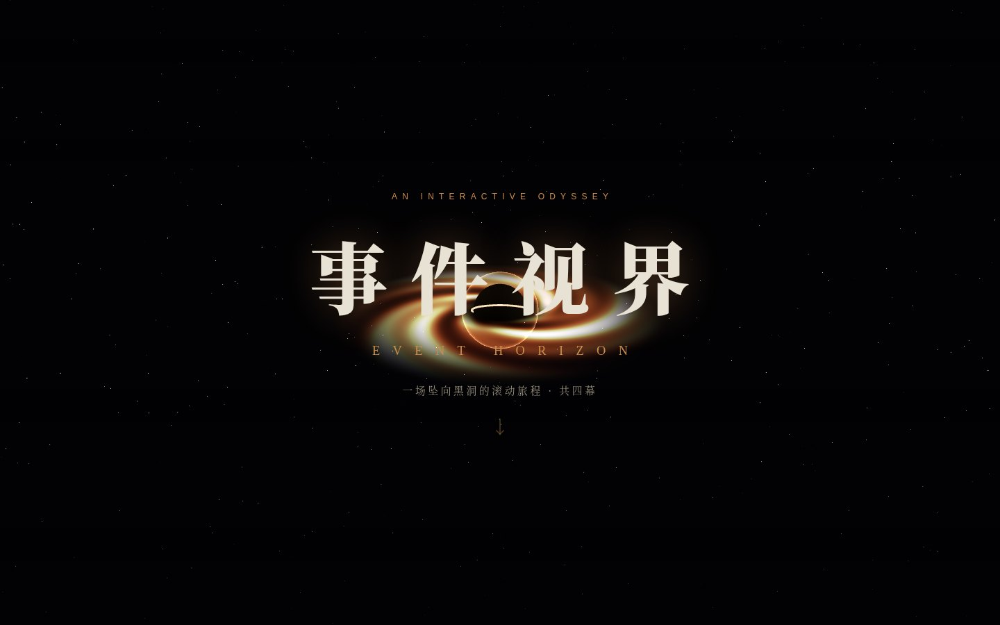
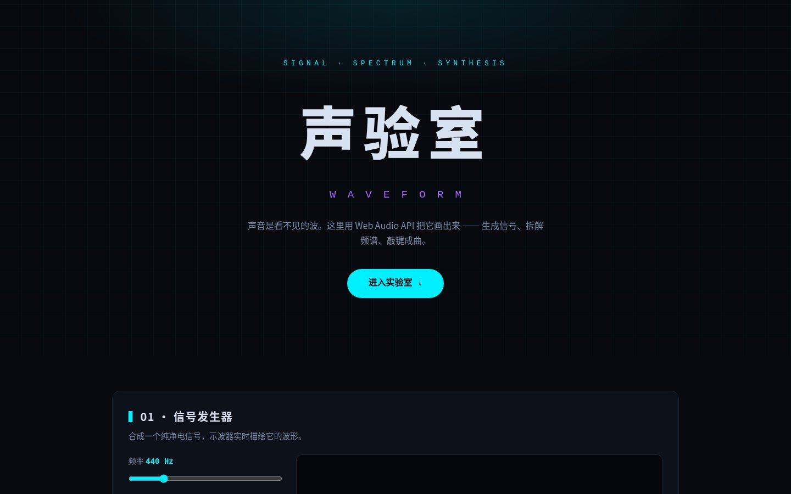

# web-showcase · 五站创意前端作品集

一个仓库，五个**主题、风格、技术栈各不相同**的创意网站 —— 覆盖 React / Next.js / Vue 3 / Svelte / 原生 JS 五种主流前端形态，每个站点独立 Docker 化，一条命令全部启动，均可经 cpolar 暴露公网演示。

## 五个站点

| # | 站点 | 主题 | 技术栈 | 端口 |
|---|------|------|--------|------|
| 1 | **Event Horizon · 事件视界** | 坠入黑洞的四幕交互叙事：滚动驱动相机穿越，自定义 GLSL 吸积盘 shader | React 18 + React Three Fiber + Three.js | 3101 |
| 2 | **拾遗 SHIYI · 数字博物馆** | 新中式文物长卷：书法描边动画、卷轴展开、水墨粒子背景 | Next.js 14（静态导出） | 3102 |
| 3 | **Waveform · 声验室** | 看得见的声音：信号发生器、实时示波器/频谱、键盘琴、麦克风可视化 | 原生 HTML/CSS/JS + Web Audio API + Canvas | 3103 |
| 4 | **Fahrenheit · 华氏书店** | 编辑排版风独立书店月刊：杂志网格、GSAP 滚动叙事、书封视差 | Vue 3 + GSAP（ScrollTrigger） | 3104 |
| 5 | **璃光 Glasshouse · 东方香氛** | 玻璃拟态品牌页：3D 倾斜产品卡、随动光泽、鼠标视差光斑 | Svelte + Vite | 3105 |

## 快速开始

### Docker（推荐，一键启动全部站点）

```bash
docker compose up -d --build
```

启动后访问：

- http://localhost:3101 — Event Horizon 黑洞
- http://localhost:3102 — 拾遗数字博物馆
- http://localhost:3103 — Waveform 声验室
- http://localhost:3104 — 华氏书店
- http://localhost:3105 — 璃光香氛

### 本地开发（需要本机安装 Node.js 20+）

```bash
cd sites/<站点目录>
npm install
npm run dev        # 开发服务器
npm run build      # 生产构建
```

## 公网演示（cpolar）

任意站点启动后，用 cpolar 把对应端口临时暴露到公网（以黑洞站为例）：

```bash
cpolar http 3101
```

输出的 `https://xxx.cpolar.io` 链接任何人可直接打开；隧道关闭即收回。五个端口可分别开五条隧道同时演示。

## 目录结构

```
sites/
  event-horizon/   # 站1 React + R3F
  shiyi/           # 站2 Next.js
  waveform/        # 站3 原生 JS（无构建，Dockerfile 直接 nginx 托管）
  fahrenheit/      # 站4 Vue 3 + GSAP
  glasshouse/      # 站5 Svelte
docs/screenshots/  # 各站运行界面截图
docker-compose.yml # 五站一键编排
```

## 运行界面

### Event Horizon · 事件视界（3101）



### 拾遗 SHIYI · 数字博物馆（3102）


### Waveform · 声验室（3103）



### Fahrenheit · 华氏书店（3104）


### 璃光 Glasshouse · 东方香氛（3105）


## License

[保留所有权利 · 未经许可禁止商用](LICENSE) — 代码公开可见供学习参考，但不授予开源许可。使用授权与商务合作请联系 GitHub @Wyy520-create。
