# web-showcase · 五站创意前端作品集

一个仓库，五个**主题、风格、技术栈各不相同**的创意网站 —— 覆盖 React / Next.js / Vue 3 / Svelte / 原生 JS 五种主流前端形态，每个站点独立 Docker 化，一条命令全部启动，均可经 cpolar 暴露公网演示。

## 五个站点

| # | 站点 | 主题 | 技术栈 | 端口 |
|---|------|------|--------|------|
| 1 | **Event Horizon · 事件视界** | 坠入黑洞的四幕交互叙事：滚动驱动相机穿越，自定义 GLSL 吸积盘 shader | React 18 + React Three Fiber + Three.js | 3101 |
| 2 | **拾遗 SHIYI · 数字博物馆** | 新中式文物长卷：书法描边动画、卷轴展开、水墨粒子背景 | Next.js 14（静态导出） | 3102 |
| 3 | **Waveform · 声验室** | 看得见的声音：信号发生器、实时示波器/频谱、键盘琴、麦克风可视化 | 原生 HTML/CSS/JS + Web Audio API + Canvas | 3103 |
| 4 | **Fahrenheit · 华氏书店** | 编辑排版风独立书店月刊：杂志网格、GSAP 滚动叙事、书封视差 | Vue 3 + GSAP（ScrollTrigger） | 3104 |
| 5 | **璃光 Glasshouse · 东方香氛** | 玻璃拟态品牌页：3D 倾斜产品卡、随动光泽、鼠标视差光斑 | Svelte + Vite | 3105 |

## 快速开始

### 方式一：Docker 一键启动全部站点（推荐，无需安装 Node.js）

**第 1 步 · 安装 Docker**

- **Windows / macOS**：到 [Docker 官网](https://www.docker.com/products/docker-desktop/) 下载 Docker Desktop 安装包，双击一路下一步；装完启动 Docker Desktop，等右下角鲸鱼图标变绿（表示 Docker 引擎已运行）。
- **Linux（Ubuntu / Debian）**：终端执行一条命令：

  ```bash
  curl -fsSL https://get.docker.com | sudo bash
  sudo usermod -aG docker $USER   # 免 sudo 使用 docker，重新登录后生效
  ```

- 安装完验证（两条命令都打印出版本号即成功）：

  ```bash
  docker --version
  docker compose version
  ```

**第 2 步 · 克隆仓库并启动**

```bash
git clone https://github.com/Wyy520-create/web-showcase.git
cd web-showcase
docker compose up -d --build
```

首次构建需要拉取基础镜像并为五个站点分别安装依赖（约 5–10 分钟，视网络速度）。全部构建完成后五个站点已在后台运行。

**第 3 步 · 浏览器访问**

| 地址 | 站点 |
|------|------|
| http://localhost:3101 | Event Horizon 黑洞叙事 |
| http://localhost:3102 | 拾遗数字博物馆 |
| http://localhost:3103 | Waveform 声验室 |
| http://localhost:3104 | 华氏书店月刊 |
| http://localhost:3105 | 璃光东方香氛 |

**常用命令**：

```bash
docker compose ps              # 查看五个站点的运行状态
docker compose logs -f         # 跟踪查看日志（Ctrl+C 退出）
docker compose down            # 停止并移除全部站点
docker compose up -d --build   # 修改代码后重新构建并启动
```

### 方式二：本地开发（需要本机安装 Node.js 20+）

**安装 Node.js**：到 [nodejs.org](https://nodejs.org/) 下载 LTS 版（≥ v20）安装包，一路下一步即可；装完终端执行 `node -v` 输出版本号即成功。Linux 也可用 nvm 安装：

```bash
curl -o- https://raw.githubusercontent.com/nvm-sh/nvm/v0.40.1/install.sh | bash
source ~/.bashrc
nvm install 20
```

进入任一站点目录安装依赖并启动开发服务器（`sites/waveform` 是纯静态原生 JS，无构建步骤，直接用浏览器打开 `index.html`，或用 VSCode Live Server 插件访问即可）：

```bash
cd sites/event-horizon      # 或 shiyi / fahrenheit / glasshouse
npm install                 # 安装依赖（仅首次需要）
npm run dev                 # 启动开发服务器，终端会打印访问地址
npm run build               # 生产构建（产物在 dist/，shiyi 在 out/）
```

## 公网演示（cpolar）

任何站点启动后，都可以用 cpolar 把对应端口临时暴露到公网，生成一个任何人（包括手机）都能直接打开的 `https://xxx.cpolar.io` 链接，按 Ctrl+C 即收回，适合做演示。

**安装与配置（仅首次需要）**：

1. 到 [cpolar 官网](https://dashboard.cpolar.com) 注册一个免费账号；
2. Linux 一键安装并填入自己的 authtoken（注册后在 cpolar 后台「验证」页可见）：

   ```bash
   curl -L https://www.cpolar.com/static/downloads/install-release-cpolar.sh | sudo bash
   cpolar authtoken <你的 authtoken>
   ```

   Windows / macOS 到 [cpolar 下载页](https://www.cpolar.com/download) 下载对应客户端，登录后自动携带 token。

**开隧道**（以黑洞站 3101 为例）：

```bash
cpolar http 3101
```

五个端口可以各开一条隧道，同时演示五个站点。

## 目录结构

```
sites/
  event-horizon/   # 站1 React + R3F
  shiyi/           # 站2 Next.js
  waveform/        # 站3 原生 JS（无构建，Dockerfile 直接 nginx 托管）
  fahrenheit/      # 站4 Vue 3 + GSAP
  glasshouse/      # 站5 Svelte
docs/screenshots/  # 各站运行界面截图
docker-compose.yml # 五站一键编排
```

## 运行界面

以下截图均为站点**真实运行的浏览器界面**（headless Chrome 截取），非设计稿或 AI 生成图。

### Event Horizon · 事件视界（3101）

滚动页面即驱动相机穿越四幕叙事，吸积盘为自定义 GLSL shader 实时渲染：

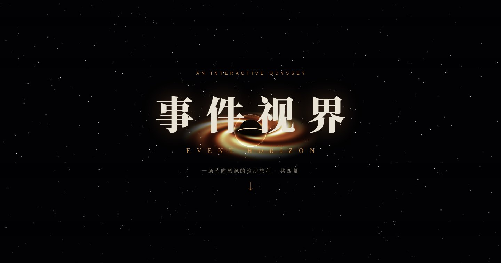

| 第一幕「光」· 相机推近中 | 第三幕「视界之内」· 黑洞近景 |
|---|---|
| 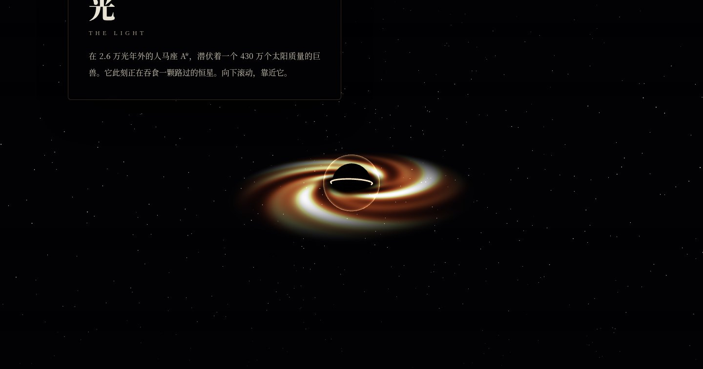 | 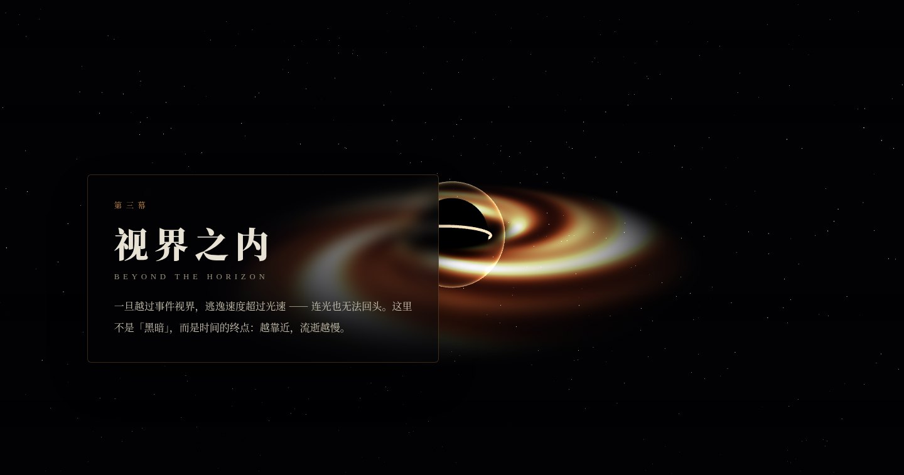 |

### 拾遗 SHIYI · 数字博物馆（3102）

书法描边逐笔显现，文物长卷滚动到视口时自动展开：

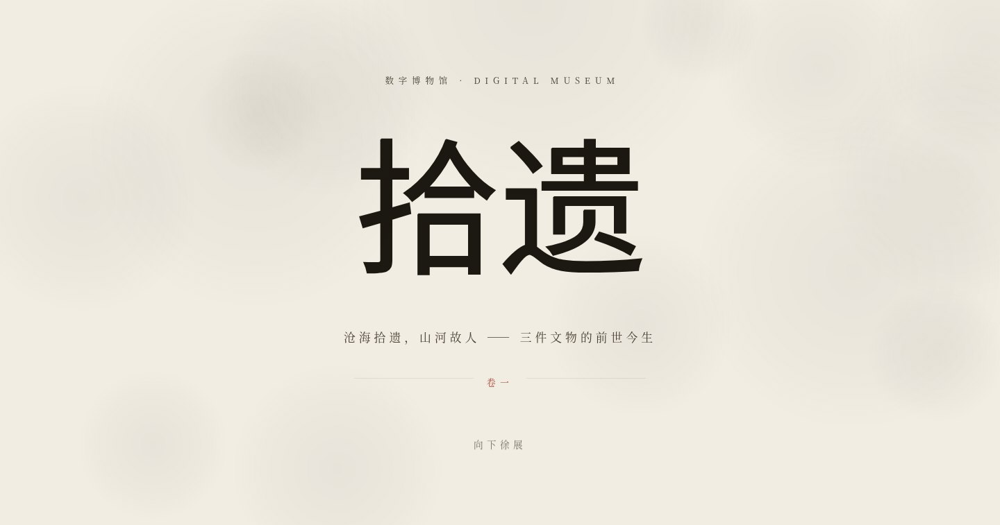

| 卷一 · 青铜爵（长卷展开） | 卷二 · 龙泉青瓷瓶（朱砂印章） |
|---|---|
| 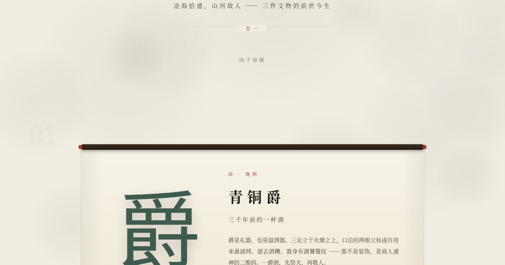 | 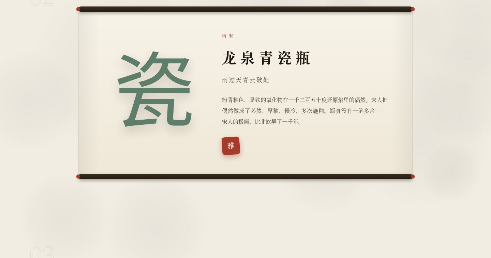 |

### Waveform · 声验室（3103）

信号发生器真实发声并实时描绘波形；键盘琴可用电脑键盘弹奏（白键 ASDFGHJK / 黑键 WETYU）：

| 信号发生器 · 440Hz 正弦实时波形 | 频谱分析 · 能量集中在 440Hz |
|---|---|
| 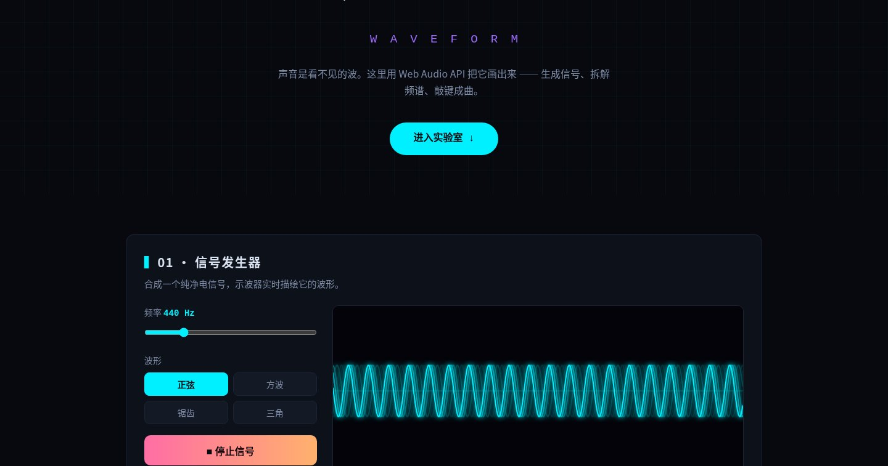 | 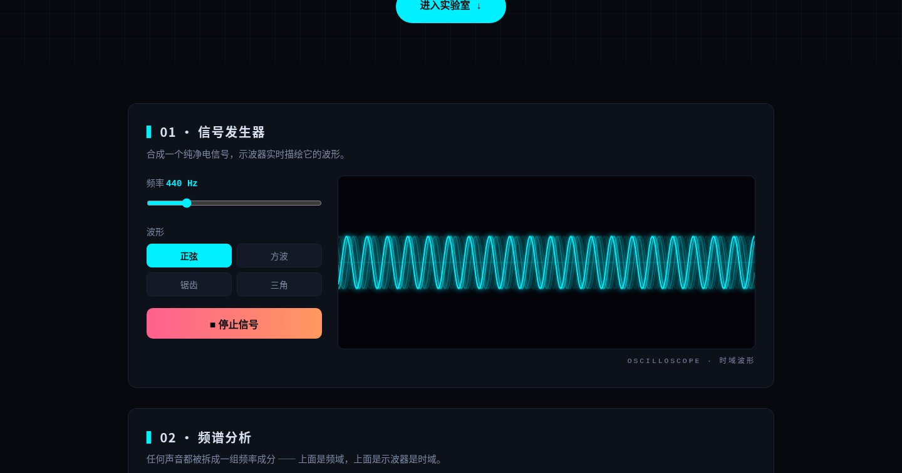 |

| 键盘琴（点击琴键或用键盘弹奏，频谱随音符跳动） |
|---|
| 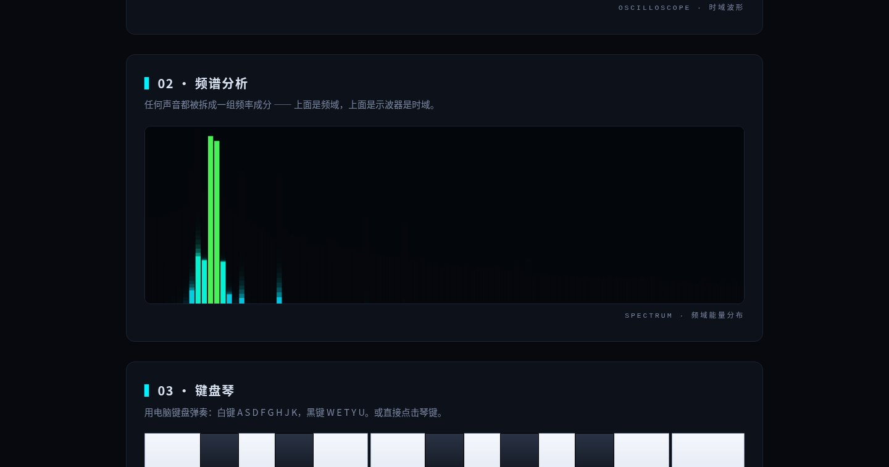 |

### Fahrenheit · 华氏书店（3104）

杂志式月刊排版，滚动驱动 GSAP 进场动画与书封视差：


| 本月书单 · 六本书封 | 编辑手记 |
|---|---|
| 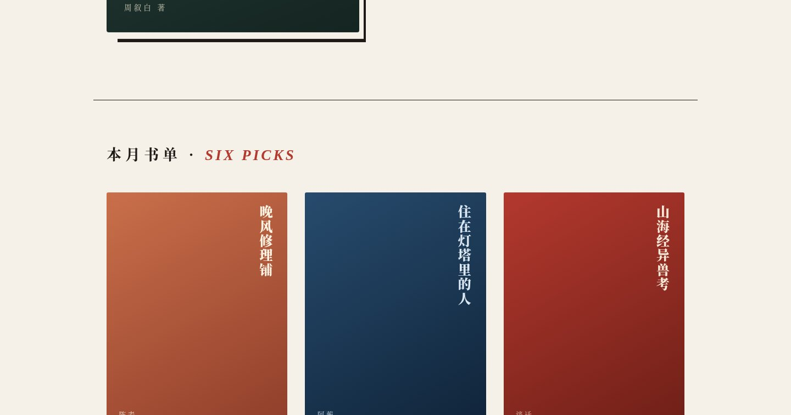 | 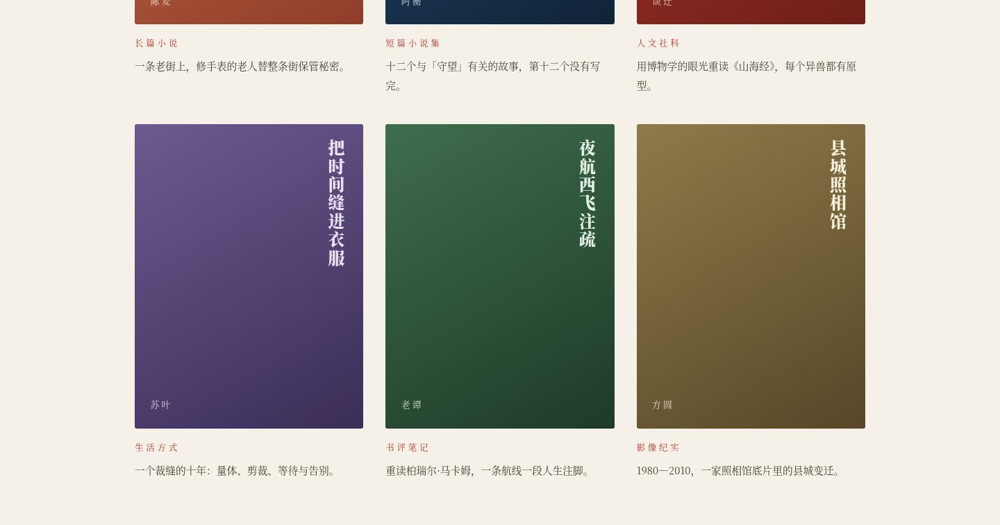 |

### 璃光 Glasshouse · 东方香氛（3105）

鼠标移动带动的视差光斑，产品卡随鼠标 3D 倾斜并出现随动光泽：


| 全系列 · 四款东方香型（CSS 绘制的玻璃香水瓶） |
|---|
| 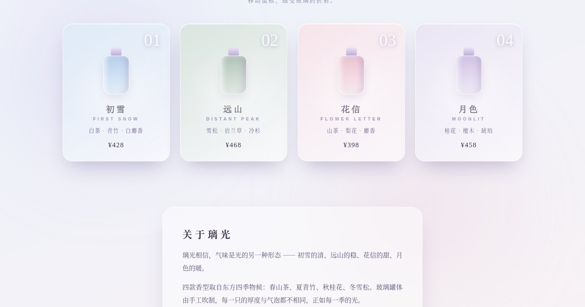 |

## License

**源代码可见（Source Available）· 保留所有权利**

- 版权所有 © 2026 **余阳辉**，保留所有权利；
- 未经许可，禁止将本项目用于任何商业用途（包括直接商用、嵌入商业产品交付、部署于产生收入的站点）；
- 禁止将本项目整体或部分镜像、搬运至其他平台或仓库；
- 允许出于个人学习、研究、演示目的阅读与运行；引用片段须署名「余阳辉」并附仓库链接；
- 使用授权与商务合作请联系 GitHub [@Wyy520-create](https://github.com/Wyy520-create)。

完整条款见 [LICENSE](LICENSE)。
